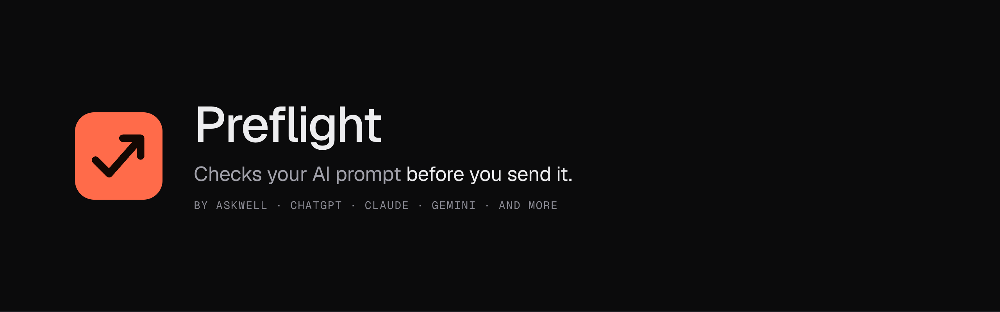
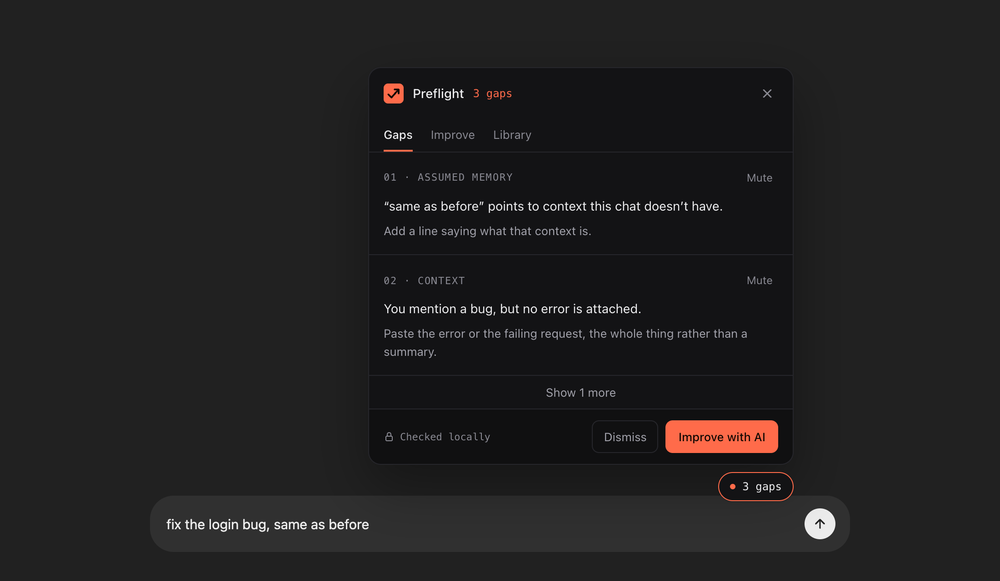
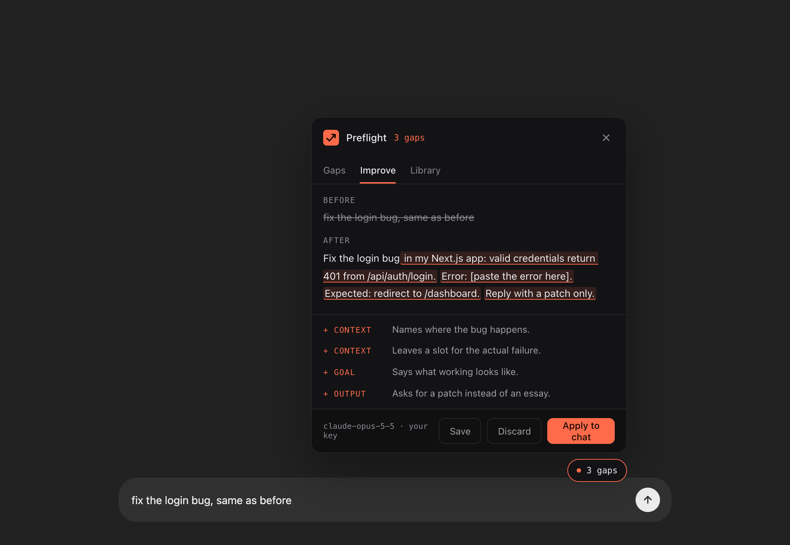
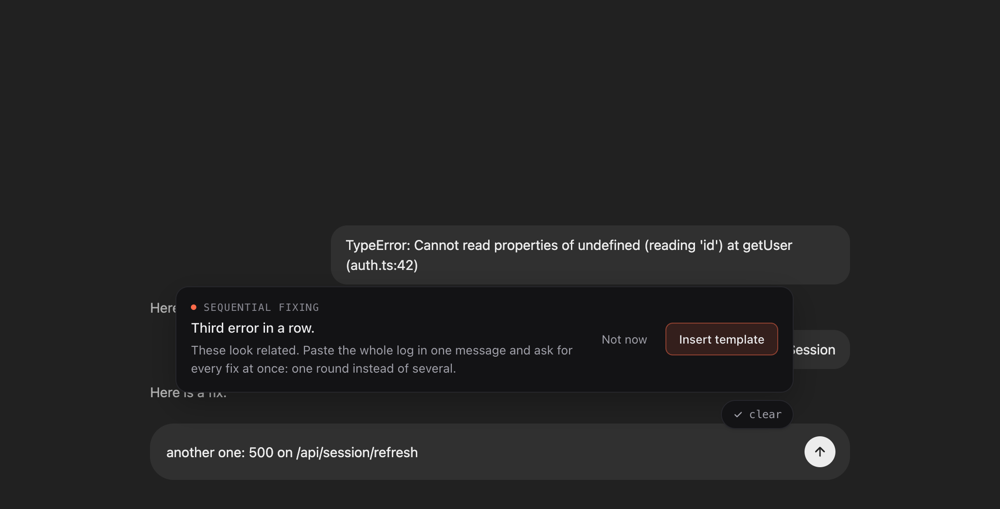
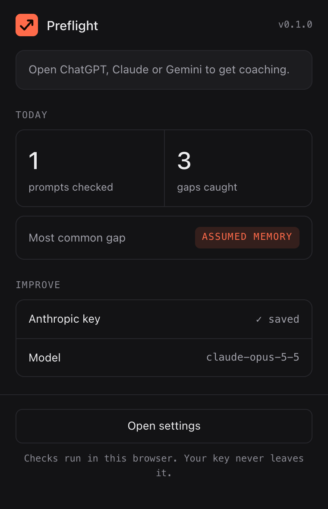
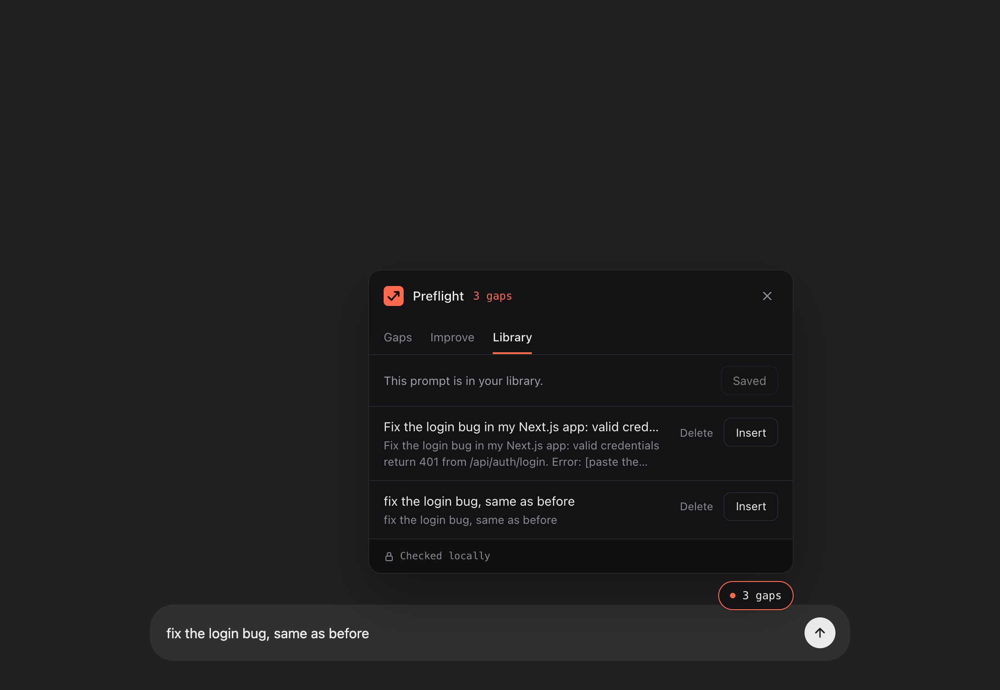
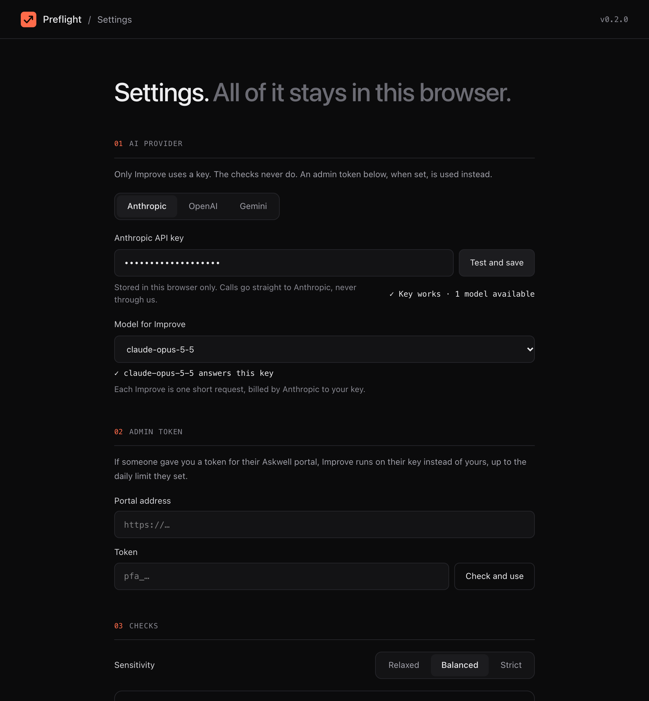

<p align="center">
  
</p>

<p align="center">
  <a href="https://github.com/shashwatgoyal-codes/askwell/releases/latest"></a>
  <a href="https://github.com/shashwatgoyal-codes/askwell/actions/workflows/ci.yml"></a>
  <a href="LICENSE"></a>
  
</p>

**Preflight** is a free browser extension that reads the prompt you are typing into an AI chat and points
out what is missing before you press Send: the error you meant to paste, what
"working" should look like, the context the AI can't see. Most wasted AI answers come from a prompt
that read as complete to the person who wrote it. Preflight catches that in the second before it
costs a round trip.

It works on **ChatGPT, Claude, Gemini, Perplexity, Copilot, Grok, DeepSeek and Le Chat**, and the same
checks run in **Claude Code** as a hook. It runs in your browser, needs no account, and only talks to an
AI provider when you ask it to.

[**Download the latest release →**](https://github.com/shashwatgoyal-codes/askwell/releases/latest)

---

## What it does

<table>
  <tr>
    <td width="50%" valign="top">
      
      <p><b>Gaps, as you type.</b> A small badge above the chat box counts what the prompt is missing.
      Click it for each gap, why it matters and how to fix it. Two at a time, never a wall of warnings.</p>
    </td>
    <td width="50%" valign="top">
      
      <p><b>Improve, with your own key.</b> One click rewrites the prompt to close the gaps and shows every
      addition highlighted, with the reason for it. <b>Apply to chat</b> puts it in the box; you still press Send.</p>
    </td>
  </tr>
  <tr>
    <td width="50%" valign="top">
      
      <p><b>Habits across the conversation.</b> Errors sent one at a time, the same fix asked for place by
      place, a new chat that assumes the last one: Preflight notices and offers a ready-made template.</p>
    </td>
    <td width="50%" valign="top">
      
      <p><b>Your week, at a glance.</b> Turn coaching off for a site, see today's numbers and the week: prompts
      per day, gaps per prompt against last week, and your most common gap. Counts only; your prompts are never stored.</p>
    </td>
  </tr>
  <tr>
    <td width="50%" valign="top">
      
      <p><b>A prompt library.</b> Save a prompt or an Improve rewrite, and insert it into any supported chat
      later. Manage it, and copy from it, in settings.</p>
    </td>
    <td width="50%" valign="top">
      <p><b>Your own rules.</b> Add checks in plain words: when a prompt mentions <i>prisma</i>, it should also
      mention <i>prisma 6</i>. They run with the built-in checks and show under their own name.</p>
      <p><b>Every AI chat you use.</b> Each site's prompt box is known by name, and where a site redesigns, the
      box you are typing in is found anyway.</p>
    </td>
  </tr>
</table>

### The checks

| Check | Flags | For example |
|---|---|---|
| **Assumed memory** | Phrases that lean on context the chat doesn't have | "same as before", "as you know", "as discussed" |
| **Context** | A bug with no error attached, code that is referred to but not pasted, a learning plan with no starting level | "the signup form is broken", "refactor this function" |
| **Goal** | No statement of what done looks like, or what a learning plan is for | "clean up the auth module", "make me a plan for system design" |
| **Constraints** | A plan with no time frame; on Strict, a code change with no limits | "8 hours a week for 3 months", "keep the public API" |
| **Output** | A plan with no format; on Strict, a code change that doesn't say what to send back | "a week-by-week plan", "reply with a patch only" |
| **Your rules** | Whatever you write in settings | "when it mentions prisma, mention the version" |

Sensitivity is **Relaxed**, **Balanced** (default) or **Strict**, and every check can be switched off.
General questions ("how does DNS work?") and ordinary requests are left alone.

### Settings

<p align="center">
  
</p>

Pick a provider (Anthropic, OpenAI or Gemini), paste your key and press **Test and save**: Preflight checks
the key, lists the models it can use and sends the chosen model one tiny test request. The popup and
settings follow your device's light or dark theme; the in-page coach follows the chat site's.

---

## Install

1. Download `preflight-<version>-chrome.zip` (Chrome, Brave, Edge) or `preflight-<version>-firefox.zip`
   from the [latest release](https://github.com/shashwatgoyal-codes/askwell/releases/latest) and unzip it.
2. **Chrome, Brave or Edge:** open the extensions page (`chrome://extensions`), turn on **Developer mode**,
   choose **Load unpacked** and pick the unzipped folder.
   **Firefox:** open `about:debugging` → This Firefox → **Load Temporary Add-on** and pick the
   `manifest.json` inside the folder. Firefox removes temporary add-ons when it restarts; a signed `.xpi`
   is attached to releases when one is available.
3. Open any supported AI chat and start typing.

The checks work without any key. To use **Improve**, open Preflight's settings and add a key:

| Provider | Get a key | Notes |
|---|---|---|
| Gemini | [aistudio.google.com/apikey](https://aistudio.google.com/apikey) | Has a free tier, with per-minute limits. Prefer a stable **Flash** model. |
| Anthropic | [platform.claude.com](https://platform.claude.com) | Prepaid credits. Defaults to `claude-opus-5-5`. |
| OpenAI | [platform.openai.com/api-keys](https://platform.openai.com/api-keys) | Prepaid credits. |

Each Improve is one short request, billed by the provider to your key. Setting a monthly spend limit in
the provider's dashboard is a good idea.

## In Claude Code

The same checks can run on every prompt you type in [Claude Code](https://code.claude.com), as a
`UserPromptSubmit` hook. It warns you in the terminal and lets the prompt through; nothing is added to
Claude's context. In block mode it stops a prompt with gaps until you edit it, or add `#go` to send it
as is. Slash commands, `!` shell commands and `#` memory notes are never checked.

1. Download `preflight-hook.mjs` from the [latest release](https://github.com/shashwatgoyal-codes/askwell/releases/latest)
   (or build it with `pnpm --filter @askwell/claude-hook build`) and put it in `~/.claude/hooks/`.
2. Add this to `~/.claude/settings.json` (merge it with any `hooks` you already have):

```json
{
  "hooks": {
    "UserPromptSubmit": [
      {
        "hooks": [
          { "type": "command", "command": "node \"$HOME/.claude/hooks/preflight-hook.mjs\"", "timeout": 5 }
        ]
      }
    ]
  }
}
```

For block mode put `PREFLIGHT_MODE=block ` before `node`; for other sensitivities set
`PREFLIGHT_SENSITIVITY=relaxed` or `strict`. It reads the session's own transcript for the
"third error in a row" kind of nudge, and needs Node 20 or later.

## Admin tokens (optional)

If you want to let a few people use Improve on **your** key, without giving them the key, run the small
[portal](apps/portal/README.md) (free on Neon + Vercel). It issues one token per person with a daily
limit and an expiry, and you can revoke any of them. They paste the token into Preflight's settings
under **Admin token**.

## Privacy

- The checks run inside your browser. Preflight has no server, no account and no analytics.
- Your API key is stored only in the extension's local storage on your device, and is sent only to the
  provider it belongs to.
- Text leaves your browser only when you click **Improve**, and then it goes only to the AI provider whose
  key you entered, under that provider's terms, or to the portal whose admin token you entered. The end-of-session summary is asked of the chat you are
  already in, so it sends nothing anywhere new.
- Today's counts in the popup are numbers only; your prompts are never stored.
- Preflight never sends a message for you. It can fill the chat box; you always press Send. Its buttons
  respond only to real clicks, so the chat page's own scripts can't trigger them.

The full policy is in [PRIVACY.md](PRIVACY.md).

## Not affiliated

Preflight works alongside ChatGPT, Claude and Gemini but is not affiliated with, endorsed by or
sponsored by OpenAI, Anthropic or Google. Those names belong to their owners and are used here only to
say which sites Preflight works with.

---

## Develop

Requires Node 22+ and pnpm.

```
pnpm install
pnpm dev            # Preflight in a fresh Chrome window, reloading on save
pnpm build          # production build in apps/preflight/dist/chrome-mv3
pnpm zip            # Chrome and Firefox zips in apps/preflight/dist
pnpm test           # unit tests (Vitest)
pnpm test:e2e       # builds, then drives Chromium with the extension loaded (Playwright)
pnpm typecheck
```

### Layout

```
apps/preflight/          the extension (WXT, React, TypeScript, Tailwind)
  entrypoints/           content script, background worker, popup, settings
  components/coach/      the in-page badge, panel, Improve view and nudges
  lib/sites.ts           where each chat site keeps its prompt box
  lib/improve/           provider calls and the JSON contract every provider meets
  e2e/                   browser tests, run against stand-in pages at the real URLs
packages/rules/          the checks: plain TypeScript, no browser APIs, fully tested
packages/claude-hook/    the same checks as a Claude Code hook, bundled to one file
packages/improve/        the rewrite contract and provider calls, shared by the extension and portal
apps/portal/             admin tokens: a small Next.js app on Neon + Vercel
docs/                    logo files and README images
```

The README images are generated, not hand-made:
`DOCS=1 pnpm --filter @askwell/preflight exec playwright test e2e/docs.spec.ts`.

### Release

Bump `version` in `apps/preflight/package.json`, commit, then tag and push:

```
git tag preflight-v0.1.1
git push origin preflight-v0.1.1
```

The Release workflow checks that the tag matches the version, runs the tests and attaches the zips to a
GitHub release. With `AMO_JWT_ISSUER` and `AMO_JWT_SECRET` set as repository secrets it also signs the
Firefox build as unlisted (signed by Mozilla, not listed publicly) so it installs permanently.

## Askwell

Preflight is the first of a small family of browser tools for asking AI well, all by
[Shashwat Goyal](https://github.com/shashwatgoyal-codes). Each has its own name and the same coral mark.

<p>
  &nbsp;
  
</p>

## License

The code is released under the [MIT License](LICENSE) and is provided as is, without warranty.

The license covers the code only. The names Askwell and Preflight and their logos are not licensed for
reuse; a fork should use its own name and logo.
